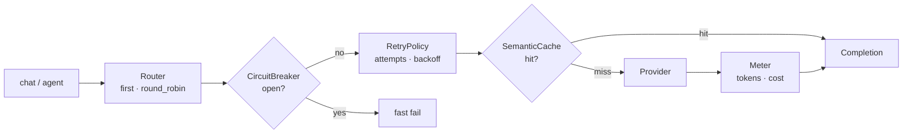

<p align="center">
  <em>Provider routing, semantic caching, retries, circuit breaking, cost metering and a tool-calling agent — on the Python standard library.</em>
</p>

<p align="center">
  
  
  
</p>

---

Six resilience pieces that normally arrive as six dependencies, wired so they
compose. Nothing to install beyond Python.

## Quick start

```python
from prism import Prism, Router, ScriptedProvider, RetryPolicy, CircuitBreaker, user

provider = ScriptedProvider(script=[
    {"match": "circuit", "content": "A circuit breaker stops calling a failing service."},
])

prism = Prism(
    router=Router([provider]),
    retry=RetryPolicy(attempts=2),
    breaker=CircuitBreaker(),
)

reply = prism.chat([user("Explain circuit breakers in one sentence.")])
print(reply.message.content)
```

**`cache`, `retry` and `breaker` take objects, not booleans.** `Prism(use_cache=True)`
raises `TypeError`. The `use_*` methods attach a component and **return that
component**, so they do not chain:

```python
prism = Prism(router=Router([provider]))
cache   = prism.use_cache()      # -> SemanticCache
retry   = prism.use_retry()      # -> RetryPolicy
breaker = prism.use_breaker()    # -> CircuitBreaker
```

```bash
python -m prism.cli demo     # fully offline
```

```text
provider : mock-gpt
answer   : It is sunny, 24C, no rain expected.
meter    : {'calls': 2, 'errors': 0, 'total_tokens': 28, 'hit_rate': 0.5}
steps    : [('multiply', {'a': 7, 'b': 5}, 35)]
```

## What is in the box

| Piece | What it does |
|---|---|
| `Router` | pick a provider by `strategy` (`first`, `round_robin`) |
| `LRUCache` / `SemanticCache` | exact-key and similarity-based response reuse |
| `RetryPolicy` | `attempts`, `base_delay`, `backoff`, `retry_on` |
| `CircuitBreaker` | `failure_threshold`, `reset_timeout`, `half_open_max` |
| `Meter` / `Trace` | token counts, cost, latency per call |
| `Prism.agent()` | ReAct loop with a `register_tool` decorator |

Providers: `OpenAICompatibleProvider` (real), `ScriptedProvider` (tests),
`EchoProvider` (smoke).

## Tool calling

```python
@prism.register_tool(description="Multiply two numbers")
def multiply(a: int, b: int) -> int:
    return a * b

result = prism.agent([user("What is 7 times 5?")], max_iter=4)
```

`name` and `description` are keyword-only; the function name becomes the tool name,
and the parameter schema is inferred from type hints.

## How the pieces compose



The order is fixed: the breaker sees failures before the retry loop, and the cache
is consulted only after the breaker lets the call through.

## Install

```bash
pip install prism-llm
```

Or copy the `prism/` package — nothing to build.

## Tests

```bash
python -m pytest -q
```

## Limitations

- **`SemanticCache` is not semantic in the embedding sense.** It compares surface
  text similarity offline; two paraphrases of the same question will not match as
  equivalent.
- **The circuit breaker is per-process.** Three workers each have their own breaker;
  one worker's failures do not open another's.
- **`ScriptedProvider` is not a simulator.** Each rule is a dict with `match` /
  `content` / `usage` / `after_tool`. It replays and raises when the script runs out.
- **Cost numbers depend on a local price table.** No network lookup; vendor price
  changes make the meter stale.

## License

MIT
